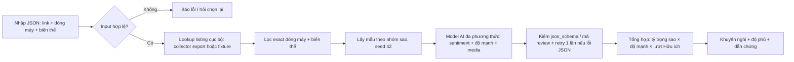

# AI SPEC — Đọc review ốp lưng Shopee · Nhóm BacTrung · L3B · Track D

> CP2: chốt chuẩn đạt ở §7 trước khi nộp; sau CP2 không sửa chuẩn hoặc `eval/metric_spec.yaml`. Khảo sát mở rộng nhiều ngành hàng; demo kỹ thuật vẫn chỉ là ốp điện thoại.

Track: **D — Thương mại điện tử** · Bài toán nghiên cứu: người mua Shopee có thể mất thời gian đọc review nhưng vẫn khó tổng hợp thông tin hữu ích để quyết định mua.

Data BTC cấp đã dùng: không.

## §0. Hiện tại việc này diễn ra thế nào *(guide 1.1)*

- Luồng dự kiến, chưa quan sát độc lập trên ứng dụng: mở listing → xem thông tin/review → tìm review liên quan → cân nhắc mua, hỏi người bán hoặc tìm nguồn khác.
- Chưa kiểm chứng tính năng lọc review hiện có của Shopee bằng ảnh/tài khoản nhóm; ghi nhận này không khẳng định Shopee thiếu tính năng đó.
- Nguồn khảo sát bước đầu: `evidence/survey/questions.md`, `evidence/survey/results.csv`; giới hạn/lọc ở `evidence/survey/data_cleaning_log.md`.

## §1. Người dùng & bằng chứng *(guide 1.1, 1.2)*

- **Đối tượng nghiên cứu:** người ngoài nhóm đã đọc review Shopee khi mua/cân nhắc mua sản phẩm bất kỳ ngành hàng nào trong 90 ngày gần nhất.
- **Người dùng demo:** người đang cân nhắc mua ốp điện thoại trên Shopee.
- **Việc demo hỗ trợ:** kiểm tra review nào áp dụng cho đúng dòng máy và biến thể ốp trước khi người mua tự quyết định.
- **Pain giả thuyết rộng:** người mua có thể tốn thời gian đọc review nhưng vẫn gặp đánh giá ngắn/khó tin/không liên quan hoặc media chưa đủ rõ để tự tổng hợp ưu, nhược điểm.
- **Bằng chứng bước đầu:** trong 64 dòng của `results.csv`, 42 đáp ứng điều kiện phân tích chính theo platform Shopee, lần gần nhất ≤90 ngày, có câu trả lời về thời lượng đọc review. Trong 42 người này, 41 chọn ít nhất một khó khăn; các lựa chọn nhiều đáp án phổ biến: review ngắn/thiếu thông tin 28/42, nghi ngờ độ tin cậy 28/42, media chưa rõ 20/42, review không liên quan mẫu/size/phiên bản 16/42, review mâu thuẫn 13/42, quá nhiều review/mất thời gian 10/42. Đây là số mô tả trong mẫu tự chọn, không phải ước lượng đại diện cho mọi người mua Shopee.
- Thời lượng đọc review ở lần gần nhất có trung vị theo nhóm **5 đến dưới 10 phút** (11/42 chọn nhóm này; 13/42 chọn dưới 5 phút). Không nhân với tần suất tìm kiếm 30 ngày để suy ra tổng thời gian/tháng vì hai câu hỏi đo hai việc khác nhau.
- **Liên hệ lát cắt ốp:** một phản hồi trong nhóm “Điện tử và phụ kiện công nghệ” nhắc rõ ốp kính: “Trước mua thử cái ốp kính, đọc đánh giá thấy cũng được mà mua về sài được mấy tuần cái viền ốp nhựa nó bị bung phải tìm cách dán lại.” — `results.csv`, mã `S055`. Đây là một tình huống đơn lẻ; không chứng minh pain riêng của toàn bộ người mua ốp hoặc nguyên nhân do review sai.
- **Giới hạn dữ liệu:** không xác minh độc lập người tham gia ngoài nhóm/trùng người; dữ liệu convenience sample và câu trả lời tự báo cáo. Chốt mẫu số CP2 theo artifact: 64 dòng trong CSV; 42 đủ điều kiện phân tích chính. Snapshot 69 được ghi là 64 dòng CSV + 5 phản hồi chờ duyệt. Con số 65 trong PR (80 tổng − 15 loại) không có dữ liệu theo dòng để kiểm chứng nên không dùng làm mẫu số; nguồn gốc tally PR chưa xác minh, không tự suy đoán dòng còn thiếu. Phân tích theo ngành hàng ở `evidence/summary.md`, tái lập bằng `python -B evidence/survey/analyze_results.py`.

## §2. Impact & quyết định chọn *(guide 1.3)*

| Hướng | Bằng chứng bước đầu | Tác động định lượng | Làm kịp? | Quyết định |
|---|---|---|---|---|
| Giúp tổng hợp review Shopee | 41/42 mẫu phân tích chọn ít nhất một khó khăn; các loại khó khăn khác nhau | Chưa suy rộng ra tổng người dùng/tháng; chưa đo thời gian cho từng lần tìm kiếm | Có, với lát cắt hẹp | Chọn làm giả thuyết sản phẩm |
| Kiểm tra review đúng biến thể ốp | Một câu trả lời mở nhắc ốp kính bị bung viền sau vài tuần | n=1 trong dữ liệu liên quan ốp; không đủ tính impact phân khúc | Có, demo fixture | Chỉ dùng làm tình huống benchmark, chưa kết luận pain phân khúc |
| So sánh tổng thể sản phẩm/nhiều ngành | Nhiều nhu cầu khác nhau theo ngành hàng | Chưa có một nhu cầu chung đủ rõ; số nhỏ ở nhiều nhóm | Quá rộng | Không chọn làm demo |

- Chưa tính impact/tháng: câu hỏi tần suất là số lần tìm kiếm/cân nhắc trên sàn, không phải số lần đọc review; thiếu đo thời gian theo từng lần. Không tự nhân hai biến khác nghĩa.
- Dữ liệu phân ngành là mô tả convenience sample, không so sánh tỷ lệ như một ước lượng dân số. Chi tiết theo nhóm ở `evidence/summary.md`.

## §3. Giải pháp tương tự *(guide 2.1)*

- Shopee là nơi người dùng khảo sát đang đọc review; nhóm chưa kiểm trực tiếp UI/bộ lọc bằng tài khoản hoặc nguồn sản phẩm chính thức. Chưa khẳng định tính năng nào có/không có.
- Khác biệt cần kiểm thử trong prototype: exact-match review theo listing + dòng máy + biến thể, kèm mã dẫn chứng và cảnh báo khi fixture không có media/đủ căn cứ.

## §4. Thiết kế *(guide 2.2, 3.2)*

- **Lát cắt một câu:** Người mua dán link Shopee, chọn dòng máy và biến thể ốp; workflow lọc review cục bộ đúng biến thể, model AI đa phương thức chấm chiều hướng/độ cụ thể kèm ảnh và frame tĩnh được chọn; người mua nhận khuyến nghị cùng review dẫn chứng để tự quyết định.
- **Không làm:** không gọi Shopee/cào web trong lúc phân tích demo; không đặt hàng hoặc nhắn người bán; không khẳng định review thật; không dùng review khác biến thể; không phân tích chuyển động video hay âm thanh.
- **Sơ đồ workflow cố định:**

- **Hình dạng:** workflow cố định; các bước tuần tự, không cần agent tự chọn công cụ.
- **Công cụ:**

  | Công cụ | Input | Output | Tác động |
  |---|---|---|---|
  | `get_product_reviews` | URL, dòng máy, biến thể, giới hạn, seed | Metadata và review exact-match từ `collector` export mới nhất hoặc `data/reviews.json`, số lượng/phân bố sao | Không; chỉ đọc file local |
  | `call_model` | JSON chứa review đã lọc + ảnh/frame tĩnh gắn mã review | JSON (`json_schema` strict) nhãn chiều hướng, độ mạnh, lý do, `media_assessment` | Gọi API OpenAI/OpenRouter (hoặc `fake` khi test offline) |
  | `agent.answer` | Input JSON và kết quả công cụ/model | JSON output có khuyến nghị, coverage, review IDs | Không |

- **Tín hiệu “Hữu ích” sau CP2:** nếu review có `helpful_count`, dùng trực tiếp số lượt người mua đánh dấu review hữu ích; đây là metadata nguồn, không phải model suy đoán. Hệ số `1 + min(log1p(n)/log1p(10), 1)` (0 lượt = 1.0; ≥10 lượt = 2.0). Review thiếu trường dùng 1.0; không tự điền. Trọng số cuối = `star_population_weight × evidence_strength_weight × helpfulness_factor`. Hệ số bị chặn ở 2.0 để phiếu hữu ích không lấn át hoàn toàn phân bố sao/bằng chứng. Giá trị `helpful_count` trong fixture chỉ synthetic; chưa xác nhận tích hợp thu thập dữ liệu Shopee.
- **Mức tự động:** AI gợi ý; người mua tự quyết định. Nếu link không có dữ liệu cục bộ, biến thể không khớp, hoặc dữ liệu quá ít (<3 review) thì không khuyến nghị mua (trả `Cần xem xét thêm` hoặc lỗi có cấu trúc).
- **Chặn rủi ro:** hostname HTTPS allowlist và exact local URL; schema input chặt; exact match metadata; giới hạn tối đa 100 review/lượt; validate mã/nhãn và `json_schema` strict (retry 1 lần nếu JSON lỗi); không thực thi chỉ dẫn trong review.
- **Người duyệt:** người mua tự quyết; không có thao tác mua hàng.
- **Nguyên tắc:**

  | Nguyên tắc | Chỗ cụ thể |
  |---|---|
  | G10 — thu hẹp khi không chắc | Link ngoài bộ dữ liệu báo `NO_LOCAL_DEMO_DATA`; biến thể sai báo `VARIANT_NOT_FOUND`; <3 review khớp chỉ trả “Cần xem xét thêm”. |
  | G1/G2 — nói rõ giới hạn | Hiển thị tổng review khớp, số đã lấy mẫu, `analysis_mode`, `source_label`, `media_note` (nêu rõ frame tĩnh không phản ánh chuyển động/âm thanh). |
  | G11 — giải thích vì sao | Dẫn mã review, sao, trích nguyên văn và lý do độ mạnh. |
  | G8/G9 — giữ người quyết định | Chỉ tư vấn, không đặt hàng hoặc thay đổi tài khoản. |

- **Phần giả:** bộ fixture mặc định (`data/reviews.json`, 14 review + 2 ảnh/frame synthetic) là `synthetic` (không dùng làm bằng chứng pain). Khi đặt `MODEL_PROVIDER=fake` để chạy unit test offline thì dùng heuristic mock (token 0); ở CP3/CP4 bản chạy thật dùng model thật (`gpt-4o` / `openai/gpt-4o-mini`).

## §5. Chỗ khó — 4 lớp, kịch bản và tấn công *(guide 2.3)*

| Kịch bản | Lớp | Hành vi mong muốn | Câu thử |
|---|---|---|---|
| Link Shopee chưa có fixture | 1 — nguồn sự thật | Nói chưa có dữ liệu, không fetch, không khuyến nghị | B05 |
| Biến thể/dòng máy không khớp | 2 — thiếu/không khớp | Hỏi chọn lại, không trộn review | B06 |
| Thiếu hoặc sai JSON | 2 — thiếu thông tin | Báo lỗi, không suy đoán | B09 |
| Review lẫn dòng máy/biến thể | 4 — đặc thù sản phẩm | Chỉ lấy exact match | B02 |
| Review positive lẫn negative | 4 — đặc thù sản phẩm | Giữ cả chiều hướng, dẫn đúng review | B03 |
| Fixture không có ảnh/video | 1 — nguồn sự thật | Ghi chưa đánh giá media | B04 |
| *(tấn công)* Thêm instruction ngoài schema | 3 — ngoài phạm vi | Từ chối input, không đổi chính sách | B07 |
| *(tấn công)* Host giả `shopee.vn.evil.example` | 3 — ngoài thẩm quyền | Từ chối trước lookup | B08 |

## §6. Bốn đường đi của trải nghiệm

- Suôn sẻ: input hợp lệ → tra review exact match → xem khuyến nghị và dẫn chứng.
- Không chắc: biến thể không khớp → xem biến thể có trong fixture/chọn lại.
- Không có căn cứ: listing ngoài demo hoặc <3 review → không khuyến nghị.
- Người dùng sửa: chọn đúng dòng máy/biến thể rồi gửi lại.
- Ngoài phạm vi/tấn công: trường instruction thêm hoặc host giả → từ chối.
- Đặc thù: review có phản ánh tiêu cực cụ thể không bị điểm sao trung bình che mất; thiếu media phải hiện rõ.

## §7. Đánh giá & chuẩn “đạt” *(guide 2.4, 4.1)*

- Data Card: `data/DATA_CARD.md`; benchmark mở rộng CP3/CP4: `eval/benchmark.csv` — **24 câu** (`thuong` 5, `kho` 13, `tu_choi` 6; gồm 6 câu tấn công; 10/24 câu định hướng từ phản hồi khảo sát, nội dung fixture vẫn synthetic).
- Metric: 3 metric ở `eval/metric_spec.yaml` (giữ nguyên sau CP2); chấm code trên input/output và dữ liệu fixture. Minh và Quang đã chấm độc lập 5 output đại diện CP2, đồng thuận 5/5. Chi tiết ở `eval/README.md` và `eval/report.md`.
- **Chuẩn đạt CP2 đã khóa:** “Đạt khi ít nhất 8/10 câu benchmark đạt; đồng thời 100% input không hợp lệ/không có fixture/không đúng biến thể không tạo khuyến nghị, và 100% dẫn chứng trỏ đúng review + listing + dòng máy + biến thể.” Câu tấn công thuộc tập bắt buộc không được thực thi; lỗi này làm không đạt dù tổng điểm ≥8/10.
- **Chính sách gợi ý trong bản demo:** cần ≥3 review exact-match; điểm có trọng số ≥0,25 → “Đáng mua”, ≤−0,25 → “Không đáng mua”, còn lại → “Cần xem xét thêm”.
- **Kết quả AI thật:**
  - **Lượt 1 (CP3):** `23/24 (96%)` — `thuong` 4/5, `kho` 13/13, `tu_choi` 6/6 (`run-1@20261128-094539`, `gpt-4o`). Lỗi duy nhất: `B10` (`ANALYSIS_UNAVAILABLE`).
  - **Lượt 2 (CP4):** `24/24 (100%)` — `thuong` 5/5, `kho` 13/13, `tu_choi` 6/6 (`run-2@20261128-104603`, `openai/gpt-4o-mini` qua OpenRouter sau khi bật `json_schema` strict, chuẩn hóa validator và retry 1 lần).

## §8. Chi phí khi dùng thật *(guide 4.2)*

- Persona và giá ở `cost/personas.yaml`. Ba persona dựa trên Q3 của 42 phản hồi hợp lệ. Quy mô 30 / 100 / 300 người dùng là *tự ước tính*. Lượt `simulate-1@20261128-104717` dùng seed `42`, chạy **50 phiên**, gồm 35 phiên gọi model và 15 phiên không gọi model. Tỉ lệ đạt đưa vào công thức là **24/24 câu** từ `eval/run-2.csv`.
- Bình quân trên cả 50 phiên (đo token bằng `openai/gpt-4o-mini`): **`$0.00084`** theo giá GPT-4o-mini, **`$0.0140`** theo giá GPT-4o và **`$0.0015`** theo giá Gemini 3.1 Flash-Lite. Mẫu số gồm mọi phiên mô phỏng. Ước tính mỗi task đạt tiêu chí của khung chia các mức bình quân cho tỉ lệ đạt benchmark theo câu, kể cả từ chối đúng. Với 35 phiên có gọi GPT-4o-mini, chi phí bình quân là **`$0.00120`/phiên**.
- Chi phí / tháng ở quy mô thật (`openai/gpt-4o-mini`): thấp (30 người) **`$0.0822`** · cơ sở (100 người) **`$0.2740`** (`$0.0027`/người/tháng) · cao (300 người) **`$0.8221`**. Chi tiết tại `cost/cost-estimate.md`.
- So với impact (§2): trung vị thời lượng đọc review người trả lời tự báo cáo là **5 đến dưới 10 phút**. Chi phí API dự kiến cho phép thử ở quy mô nhỏ. Cần đo thời gian thực sự tiết kiệm được khi người mua dùng app với review thật.

## §9. Rủi ro & an toàn

- Khảo sát được mô tả là ẩn danh, không thu tên/email/điện thoại; vẫn rà lại CSV/log để không đưa thông tin nhận diện lên repo. Synthetic fixture không phải dữ liệu pain.
- Không suy rộng từ convenience sample; không gộp các ngành hàng thành một pain; không dùng 41/42 để tuyên bố mọi người mua gặp khó.
- AI không được khẳng định review là thật, suy diễn về ngành hàng khác, mở URL người dùng gửi hoặc đặt hàng.

## §10. Phân công & changelog

- Nghĩa: spec/UI/tích hợp · Nhật: khảo sát/bằng chứng và dữ liệu review mẫu/công cụ tra cứu · Minh: mô phỏng chi phí/benchmark/eval · Quang: workflow/model/demo (chi tiết `PLAN.md`).
- Khai báo AI: `docs/ai-usage.md`.

| Thời điểm | Đổi gì | Vì sao |
|---|---|---|
| CP2 | Cập nhật bằng chứng khảo sát đã merge; tách khảo sát đa ngành khỏi demo ốp; chốt workflow, benchmark, metric và chuẩn đạt | PR #3, `results.csv`, giới hạn mẫu và scope `PLAN.md` |
| Sau CP2 · 27/11/2026 | Thêm số lượt “Hữu ích” làm hệ số bounded trong tổng hợp; không đổi metric spec hoặc chuẩn đạt CP2 | Yêu cầu bổ sung tín hiệu hữu ích thu thập được cùng review |
| CP3 · 28/11/2026 | Nối model thật (`gpt-4o`), tích hợp web UI (`codebase/app.py`), `Shopee_Collector`, mở rộng benchmark 24 câu và chạy lượt 1 (`23/24`, lỗi `B10`) | PR #7–#11; đáp ứng yêu cầu model thật đa phương thức và benchmark ≥20 câu |
| CP4 · 28/11/2026 | Hỗ trợ OpenRouter, dùng `json_schema` strict, chuẩn hóa validator và thử lại một lần. Chạy lượt 2 (`24/24`, `openai/gpt-4o-mini`) và mô phỏng chi phí 50 phiên (`simulate-1`) | B10 trả được phân tích ở lượt 2. Lượt này đổi cả model và cách xử lý JSON. Chi tiết ở `eval/report.md` và `cost/cost-estimate.md`. |
